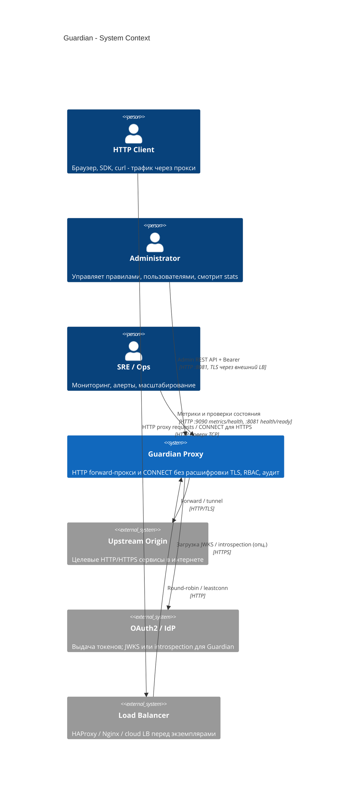
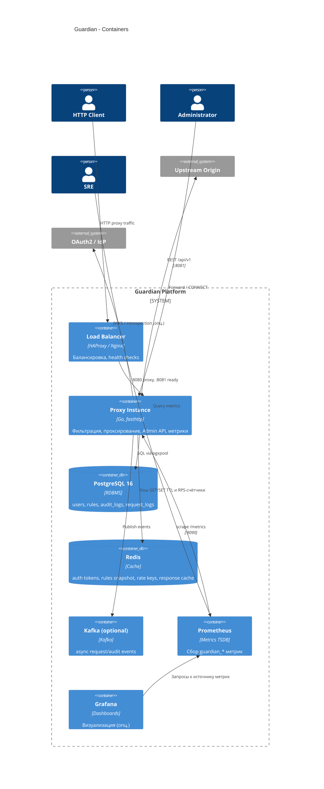
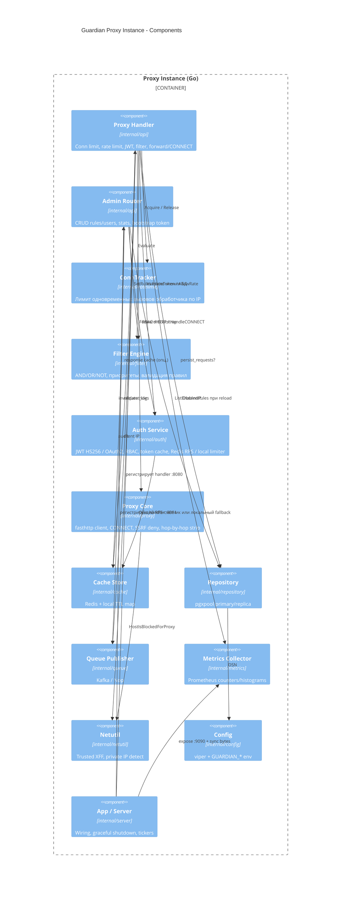
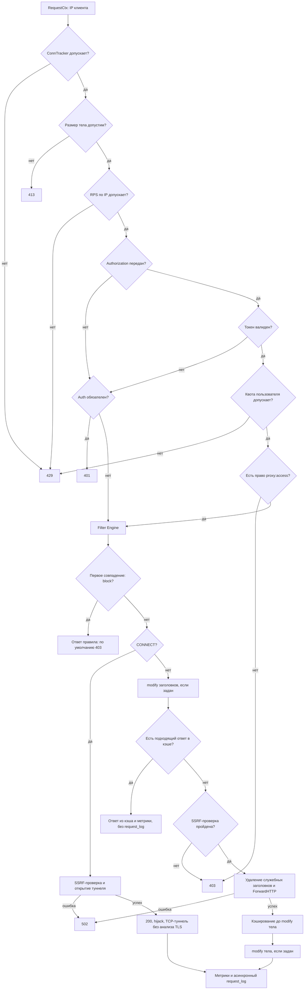
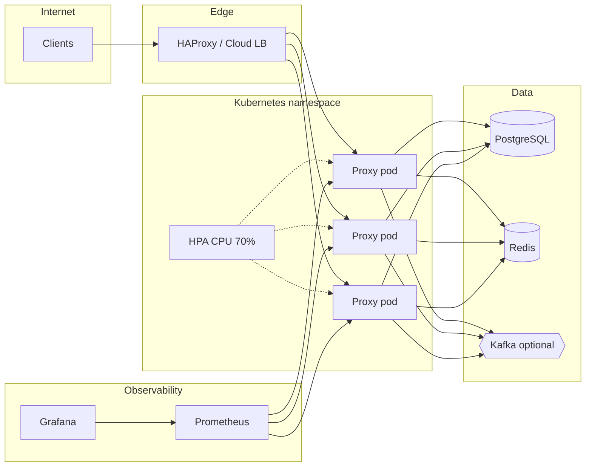

# C4-модель: Guardian Proxy

Диаграммы [C4](https://c4model.com/) показывают окружение Guardian, развёртываемые сервисы и компоненты процесса. Последовательность обработки запроса представлена отдельно в flowchart. Для просмотра нужен рендерер Mermaid с поддержкой C4 и flowchart.

Связанные материалы: [architecture.md](./architecture.md), [ТЗ](../doc/task.md).

---

## Уровень 1. Контекст системы

Клиенты обращаются к целевым серверам через Guardian. Администратор управляет правилами и пользователями через Admin API; служба эксплуатации получает метрики и проверяет состояние сервиса.

### Участники и внешние системы

| Актор / система | Роль относительно Guardian |
|-----------------|----------------------------|
| HTTP Client | Источник проксируемого трафика |
| Administrator | CRUD правил и пользователей |
| Upstream | Назначение после allow/modify |
| OAuth2 / IdP | Внешний источник токенов; альтернативный локальный режим HS256 реализован в Guardian |
| Load Balancer | Горизонтальное масштабирование нескольких экземпляров |
| SRE | Наблюдаемость и HPA |

---

## Уровень 2. Контейнеры

Прокси, хранилища и сервисы мониторинга развёртываются отдельно. Балансировщик направляет запросы на экземпляры Guardian.

### Порты экземпляра Guardian

| Порт | Контейнерная ответственность |
|------|------------------------------|
| `:8080` | Публичный прокси (HTTP + CONNECT) |
| `:8081` | Admin API, `/health`, `/ready` |
| `:9090` | Prometheus `/metrics`, `/health` |

### Масштабирование

- **Proxy Instance** - горизонтально: пример HPA задаёт целевую среднюю загрузку CPU 70% от requests.
- **PostgreSQL** - primary и опциональная read replica для всех операций чтения, включая правила и пользователей.
- **Redis** - общий кэш для экземпляров.
- **Kafka** - опционально; публикация при `queue.enabled=true` и `queue.backend=kafka`; иначе используется NopPublisher.

---

## Уровень 3. Компоненты процесса Guardian

Внутренние компоненты процесса `cmd/proxy` / пакеты `internal/*`.

### Компоненты и пакеты

| Component | Пакет |
|-----------|--------|
| App / Server | `internal/server` |
| Proxy Handler / Admin Router | `internal/api` |
| Filter Engine | `internal/filter` |
| Auth Service | `internal/auth` |
| Proxy Core | `internal/proxy` |
| Cache Store | `internal/cache` |
| Repository | `internal/repository` |
| Queue Publisher | `internal/queue` |
| Metrics | `internal/metrics` |
| Netutil | `internal/netutil` |
| Config | `internal/config` |
| ConnTracker | `internal/ratelimit` |

---

## Обработка запроса на уровне кода

Уровень кода для одного входящего запроса на `:8080` (упрощённо).

Диаграмма показывает логические этапы обработчика; ограничения RPS выполняются только при `rate_limit.enabled: true`. Лимит размера тела также применяется сервером до вызова обработчика. `ConnTracker.Release` выполняется при выходе из обработчика, поэтому не учитывает время жизни туннеля после hijack. Для CONNECT метрики длительности и журнал отражают открытие туннеля.

Ключевые типы и функции:

| Шаг | Символ |
|-----|--------|
| IP | `netutil.ClientIP`, `ratelimit.ConnTracker` |
| Auth | `auth.Service.ValidateToken`, `TokenClaims.QuotaRPS` |
| Filter | `filter.Engine.Evaluate`, `models.ConditionNode` |
| Forward | `proxy.Core.ForwardHTTP`, `ErrPrivateTarget` |
| Tunnel | `proxy.Core.HandleCONNECT` |

---

## Развёртывание

Пример с тремя репликами Guardian за балансировщиком. PostgreSQL, Redis и Kafka общие для реплик. Grafana запрашивает метрики у Prometheus.

---

## Легенда C4

| Элемент | Смысл |
|---------|--------|
| **Person** | Человек / роль |
| **System** | Программная система (граница продукта) |
| **Container** | Отдельно разворачиваемый процесс или хранилище |
| **Component** | Модуль внутри контейнера (в Guardian соответствует Go-пакету или слою) |
| **Code** | Классы/функции на критическом пути |

---

## Связь диаграмм с реализацией

Рабочий набор правил находится в памяти процесса и обновляется из PostgreSQL. Redis используется для кэширования и общих RPS-счётчиков; открытые соединения и резервные ограничители остаются локальными. Направление связей на диаграммах показывает, какой компонент обращается к другому.

CONNECT передаёт TCP-трафик без расшифровки TLS. Диаграмма обработки описывает открытие туннеля; запросы внутри него не проходят через Filter Engine повторно.

Ограничения реализации проверки и отзыва токенов, SSRF-проверок, аудита и readiness приведены в [architecture.md](./architecture.md). Настройки и примеры запуска - в [instruction.md](./instruction.md).
